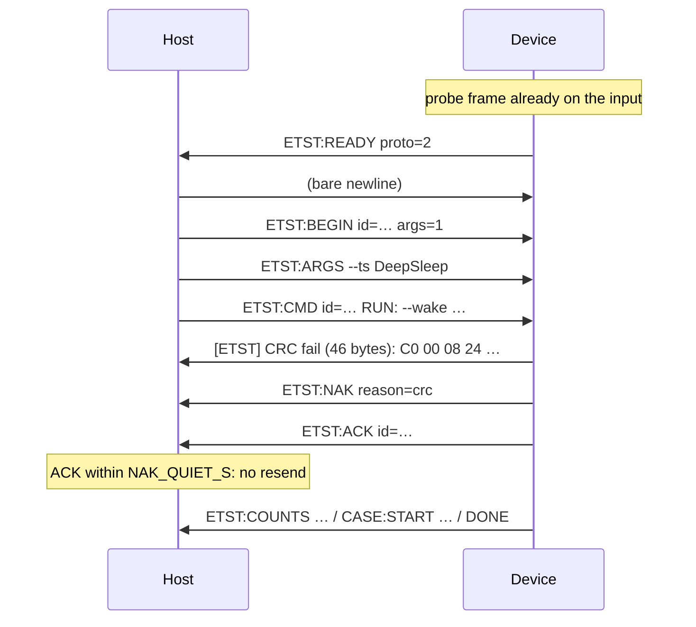

# embedded-test-runner — Design

PlatformIO test orchestration for embedded devices. Handles what
`pio test` can't: devices that sleep, reset, disconnect, or crash
during test execution.

## Motivation

PlatformIO's built-in test runner assumes a stable serial connection
from upload through test completion. Real embedded testing breaks this
assumption constantly:

- **Deep sleep** — the device enters deep sleep mid-test; USB-CDC
  disappears; PIO declares the test failed
- **Reset** — a watchdog reset or deliberate reboot loses the serial
  connection; PIO can't recover
- **Long operations** — a GPS fix or cellular connection takes minutes; not easily distinguishable from a real hang.
- **Crashes** — a backtrace scrolls past; PIO doesn't distinguish
  "crash" from "test output"

embedded-test-runner extracts these patterns into a standalone PlatformIO
plugin with reusable firmware headers.

## Architecture

```
Host (Python)                          Device (C++ firmware)
─────────────                          ────────────────────
EmbeddedTestRunner                     etst/doctest/runner.h
  ├─ ReadyRunProtocol                    ├─ wait_for_command()
  │    state machine:                    │    sends ETST:READY
  │    READY→RUN→DONE                    │    receives RUN:/RUN_ALL
  ├─ CrashDetector                       ├─ run_cycle()
  │    backtrace, WDT, panic             │    apply filters
  ├─ MemoryTracker                       │    modify_skip (unskip/skip)
  │    ETST:MEM:BEFORE/AFTER             │    context.run()
  ├─ TimingTracker                       │    signal_done()
  │    ETST:CASE:START                   ├─ idle_loop()
  ├─ RobustDoctestParser                 │    SLEEP/RESTART/re-run
  │    doctest output → results          └─ etst/test_runner.h
  └─ DisconnectHandler                       ETST: protocol emit helpers
       ETST:DISCONNECT/RECONNECT
```

### How it works with PlatformIO

PlatformIO manages build/upload. The runner is selected via:

```ini
[env:esp32s3]
test_framework = custom
lib_deps =
    https://github.com/m-mcgowan/embedded-test-runner.git
```

A `test_custom_runner.py` shim imports `EmbeddedTestRunner` and PIO
calls its `stage_testing()` method. The runner opens the serial port,
runs the READY/RUN/DONE handshake, processes output through the
receiver pipeline, and reports results back to PIO.

### Where embedded-bridge fits

The runner uses **embedded-bridge** for:
- CRC-8 checksums on protocol lines (transport integrity)
- `Router` for dispatching serial lines to multiple receivers
- `CrashDetector` patterns (backtrace, guru meditation, WDT, abort)

The runner does NOT create a `Bridge` instance — PIO owns the serial
connection (or the runner opens it directly for the custom framework).

## Core Components

### ETST Protocol (`protocol.h`, `protocol.py`)

All protocol messages use the `ETST:` prefix with CRC-8 checksums.
The firmware emits via `etst::emit()`, the host validates
via `validate_crc()`.

| Message | Direction | Purpose |
|---------|-----------|---------|
| `ETST:READY [proto=2]` | Device→Host | Device ready for commands; `proto=2` offers transactions |
| `RUN_ALL` | Host→Device | Run all tests |
| `RUN: <flags>` | Host→Device | Run with filters |
| `RESUME_AFTER: <name>` | Host→Device | Skip tests up to name |
| `ETST:ARGS <token …>` | Host→Device | Pre-RUN configuration (e.g. `--env K=V`); repeatable |
| `ETST:BEGIN id=<id> args=<n>` | Host→Device | Open a transaction of n `ETST:ARGS` lines (proto 2) |
| `ETST:CMD id=<id> <command>` | Host→Device | Close it: run `<command>` (proto 2) |
| `ETST:ACK id=<id> [dup=1]` | Device→Host | Transaction's command taken (`dup=1`: already ran, not rerun) |
| `ETST:NAK reason=<crc\|incomplete\|malformed> …` | Device→Host | A line was refused |
| `ETST:COUNTS total=N skip=N run=N` | Device→Host | Test count before execution |
| `ETST:CASE:START suite=".." name=".."` | Device→Host | Test timing marker |
| `ETST:MEM:BEFORE free=N min=N largest=N` | Device→Host | Heap before test |
| `ETST:MEM:AFTER free=N delta=N min=N largest=N` | Device→Host | Heap after test |
| `ETST:DONE` | Device→Host | All tests complete |
| `ETST:SLEEP ms=N` | Device→Host | Entering deep sleep |
| `ETST:RESTART` | Device→Host | Software restart imminent |
| `ETST:BUSY ms=N` | Device→Host | Busy, extend hang timeout |
| `ETST:DISCONNECT ms=N` | Device→Host | Serial going away |
| `ETST:RECONNECT` | Device→Host | Serial restored |
| `SLEEP` | Host→Device | Enter deep sleep (idle) |
| `LIGHTSLEEP` | Host→Device | Enter light sleep (idle) |
| `RESTART` | Host→Device | Restart device (idle) |
| `WAIT` | Host→Device | Stay in the idle loop |
| `LIST` | Host→Device | List registered tests |

### ReadyRunProtocol (`ready_run_protocol.py`)

State machine for the READY/RUN/DONE handshake:

1. Device boots, sends `ETST:READY` periodically
2. Host sends `RUN_ALL`, `RUN: <filters>`, or `RESUME_AFTER: <name>`
3. Device runs tests, may emit `ETST:SLEEP` for deep sleep
4. Device sends `ETST:DONE` when finished

The state machine handles:
- CRC validation on host→device commands
- Garbage byte stripping (USB-CDC DTR assertion noise)
- Timeout detection with configurable hang threshold
- SLEEP sentinel detection + device reconnection
- Delivering each command exactly once (below)

#### Command delivery: exactly once

The serial input is shared. Anything that opens the port can write to it,
and on a USB-CDC device that re-enumerates after every deep sleep, things
do: a USB hub agent that probes each newly attached port with an ESP32
ROM-bootloader SYNC frame (`C0 00 08 24 … 07 07 12 20` + 32 × `55`, `C0`, no
newline) put that frame on the device's input at every wake. It was glued
to the front of the host's first `ETST:ARGS` line. A v0.3.x device then
refused that line, dropped the argument, announced READY again, and ran the
command on the remaining arguments; the host took the second READY to mean
"command lost" and sent it again, and the device ran a post-wake test phase
twice.

Three layers now keep a command from being lost, damaged or repeated:

1. **The host terminates noise first.** Before the configuration it writes
   a bare `\n`, so bytes already sitting on the device's input fail as a
   line of their own instead of taking the host's first line with them.
2. **The device recovers a glued line.** If a line fails its CRC, the
   device tries once more from its first `ETST:`, provided the bytes in
   front contain no `ETST:` of their own (those would be the remains of a
   damaged protocol line, whose loss must be reported, not hidden).
3. **Transactions (protocol 2).** A device that announces
   `ETST:READY proto=2` is sent

   ```
   ETST:BEGIN id=3aee6b82 args=1
   ETST:ARGS --ts DeepSleep
   ETST:CMD id=3aee6b82 RUN: --wake --tc "survives deep sleep"
   ```

   It runs the command only if the BEGIN with that id arrived and exactly
   `args` arguments followed, replying `ETST:ACK id=<id>` before it runs.
   Anything else is refused with `ETST:NAK` and the host resends the whole
   transaction, under the same id. The device remembers the last id it ran
   and answers a copy with `ETST:ACK id=<id> dup=1` without running it, so
   a resend can never run a command twice. The id is 8 random hex digits
   per command.



**When the host resends.**

| Device | Resends when | Never on |
|--------|--------------|----------|
| protocol 2 | a NAK followed by `NAK_QUIET_S` (0.5 s) without our ACK, or no ACK within `ACK_TIMEOUT_S` (2 s); after `MAX_RESENDS` (5) the run fails with error code `protocol` | READY (it is periodic) |
| protocol 1 (v0.3.x) | a second READY with no `ETST:COUNTS` or `ETST:CASE:START` in between | the first READY after sending |

A protocol-1 device that took the command is busy running it and announces
nothing; one still waiting announces READY every second. So two READYs with
no sign of a run mean the command was lost, while a single one may be the
device re-announcing after refusing noise in front of an intact command.
Against a protocol-1 device the host cannot tell which line a refusal hit,
so noise arriving *between* two of its lines can still cost an argument;
protocol 2 detects that (`NAK reason=incomplete`) and resends.

**The end-of-run command travels the same way.** After the last `ETST:DONE`
the runner sends the `ETST_ON_DONE` command (`WAIT` by default, or `SLEEP`,
`LIGHTSLEEP`, `RESTART`) to the device's idle loop. It is CRC-framed after a
bare newline; to a protocol-2 device it is a transaction with no arguments
(`ETST:BEGIN id=… args=0`, `ETST:CMD id=… SLEEP`), resent under the same id
until `ETST:ACK` arrives (at most `MAX_RESENDS` times, `ACK_TIMEOUT_S` each).
Up to v0.3.x it was written without a CRC, so every device refused it and
`ETST_ON_DONE` had no effect.

**The device no longer re-announces READY when it refuses a line**: it
sends `ETST:NAK`. A host that predates the NAK still gets the periodic READY
within a second, and resends on it as before.

### EmbeddedTestRunner (`runner.py`)

PlatformIO test runner plugin. Key methods:

- `stage_testing()` — main entry: opens serial, runs test cycles,
  handles sleep/wake loops, reports results
- `_build_initial_command()` — combines `-a` program args with
  `ETST_*` environment variables into a `RUN:` command
- `_run_test_cycle()` — single READY→RUN→DONE cycle with crash
  detection and hang monitoring

### DisconnectHandler (`disconnect.py`)

Manages disconnect/reconnect windows for devices that sleep, reset,
or reconfigure during tests. The firmware controls the timing:

```cpp
etst::request_disconnect(5000);  // going away for 5s
Serial.end();
// ... sleep / reset / reflash ...
Serial.begin(115200);
etst::signal_reconnect();        // back
```

### CrashDetector (from embedded-bridge)

Detects device crashes from serial output patterns:
- `Backtrace:` — ESP32 backtrace
- `Guru Meditation` — ESP32 panic
- `abort()` / `assert failed`
- `E (NNNN) task_wdt:` — Task watchdog timeout
- `Rebooting...` — Post-crash reboot

### Doctest Runner (`etst/doctest/runner.h`)

Firmware-side test harness for doctest. Provides:

- `DOCTEST_SETUP()` / `DOCTEST_LOOP()` — call from Arduino setup/loop
- `EtstDoctestListener` — doctest reporter emitting ETST markers
- `wait_for_command()` — READY/RUN handshake; each line goes through
  `CommandReceiver` (`etst/doctest/command_receiver.h`): CRC, noise
  recovery, transactions, duplicate suppression, ACK/NAK
- `run_cycle()` — apply filters, run tests, signal done
- `idle_loop()` — post-test command loop (SLEEP, RESTART, re-run)

**Configuration:**

Framework-agnostic (`etst::config`):

| Field | Signature | Purpose |
|-------|-----------|---------|
| `board_init` | `bool fn(Print&)` | Board setup before tests (return false to halt) |
| `after_cycle` | `void fn()` | Called after each test cycle completes |
| `ready_timeout_ms` | `uint32_t` | Max wait for host (default: 0 = forever) |
| `platform_restart` | `void fn()` | Custom restart (default: `esp_restart()`) |
| `platform_sleep` | `void fn()` | Custom deep sleep (default: `esp_deep_sleep_start()`) |
| `platform_lightsleep` | `void fn()` | Custom light sleep (default: `esp_light_sleep_start()`) |

Doctest-specific (`etst::doctest::config`):

| Field | Signature | Purpose |
|-------|-----------|---------|
| `configure` | `void fn(doctest::Context&)` | Configure doctest context before run |

### Test Filtering

Two-phase filter processing in `apply_run_filters()`:

1. **ETST-specific flags** (`--unskip-tc`, `--skip-tc`, etc.) modify
   `m_skip` on the doctest test registry. Processed left-to-right
   so later flags override earlier ones.
2. **Remaining flags** passed to `context.applyCommandLine()` for
   doctest's native filter processing (`--tc`, `--ts`, `--tce`,
   `--tse`, `--no-skip`, comma-separated patterns, etc.).

Compile-time filters (`TEST_FILTER_SUITE`, etc.) are applied first
and compose additively with runtime filters.

### Sleep/Wake Orchestration

When a test enters deep sleep:

1. **First cycle**: `RUN_ALL` — tests run until one calls
   `signal_sleep()`.
2. **Sleep resume**: Host waits, reconnects, sends
   `RUN: --wake --tc "<sleeping_test>"` — runs Phase 2 only.
   The `--wake` flag tells the firmware that this is a Phase 2 wake
   cycle so `etst::is_test_wake()` returns true.
3. **Remaining cycle**: `RESUME_AFTER: <sleeping_test>` — device
   uses doctest's `first` option to skip past completed tests.
4. **Repeat**: If another test sleeps during step 3, the loop
   continues.

### Test Environment Variables (`<etst/env.h>`, `ETST:ARGS`)

Hosts can forward arbitrary key-value pairs to the firmware before each
test run. The runner collects them from two sources:

- Host environment variables prefixed `ETST_ENV_*` (the prefix is
  stripped before forwarding — `ETST_ENV_HAS_GPS=1` becomes `HAS_GPS=1`)
- `pio test -a "--env KEY=VALUE"` program arguments

The runner emits one `ETST:ARGS --env KEY=VALUE` line per pair before
the `RUN` command. Firmware accumulates them into a per-cycle env store
cleared at each `READY`.

**Firmware lookups (`<etst/env.h>`):**

```cpp
const char* gps   = etst::env("HAS_GPS");           // nullptr if unset
bool        debug = etst::env<bool>("DEBUG", false);
int         baud  = etst::env<int>("UART_BAUD", 115200);
```

**Conditional skipping** via the `require_env` doctest decorator:

```cpp
TEST_CASE("GPS fix" * etst::require_env("HAS_GPS"))         { ... }
TEST_CASE("v1.10"   * etst::require_env("DEVICE_REV","1.10")) { ... }
```

Tests whose requirements aren't met emit `ETST:WARN` and skip cleanly.

### Receiver Plugins (`embedded_test_runner.receivers`)

Other Python packages can attach receivers to the runner without
per-project glue code. `EmbeddedTestRunner.__init__` walks the
`embedded_test_runner.receivers` setuptools entry-point group,
instantiates each plugin class with `runner=self`, reads an optional
`predicate` attribute or method, and adds the instance to
`self.router`. Failures (import, construction, missing `feed`) are
logged and skipped. See README "Receiver plugins" for the consumer
contract.

**Plugin class shape:**

```python
class MyReceiver:
    def __init__(self, runner): ...
    def predicate(self, message): ...     # optional filter
    def feed(self, message): ...
    def on_partition_start(self): ...     # optional, fired in setup()
    def on_partition_complete(self): ...  # optional, fired in teardown()
```

**Lifecycle hooks** on `EmbeddedTestRunner` itself:

- `on_partition_start()` — called from `setup()` before
  `stage_testing` runs.
- `on_partition_complete()` — called from `teardown()` after the test
  cycle finishes.

Default implementations forward to plugin receivers that opt in.
Subclasses overriding either should call `super()` to preserve plugin
notification.

This is the integration point that lets `pio-gcov` capture per-partition
`COV:` lines without each consumer project having to subclass
`EmbeddedTestRunner` and register a receiver by hand.

## Project Structure

```
embedded-test-runner/
├── pyproject.toml               # Python package config (setuptools_scm)
├── library.json                 # PlatformIO library metadata
├── LICENSE
├── README.md
├── CHANGELOG.md
├── docs/
│   └── design.md                # this file
├── include/
│   └── etst/
│       ├── protocol.h           # CRC-8 wire format, emit() helper
│       ├── test_runner.h        # firmware protocol API (disconnect, sleep, memory)
│       └── doctest/
│           ├── command_receiver.h # host lines → commands, exactly once (ACK/NAK)
│           └── runner.h         # doctest integration (filters, READY/RUN, idle loop)
├── src/
│   └── etst/
│       ├── __init__.py          # exports EmbeddedTestRunner
│       ├── runner.py            # PIO plugin: EmbeddedTestRunner
│       ├── protocol.py          # CRC-8 format/validate, line parsing
│       ├── ready_run_protocol.py # READY/RUN/DONE state machine
│       ├── disconnect.py        # DisconnectHandler
│       ├── result_receiver.py   # TestResultReceiver (multi-framework)
│       ├── robust_doctest_parser.py  # fixes PIO doctest parser crash
│       └── timing_tracker.py    # per-test duration + slow test report
├── examples/
│   └── test_custom_runner.py    # copy to project; auto-installs deps
├── scripts/
│   └── release.sh               # version bump, tag, push, GH release
└── tests/
    ├── conftest.py              # PIO mock infrastructure
    ├── test_runner.py           # EmbeddedTestRunner tests
    ├── test_protocol.py         # CRC-8 format/validate tests
    ├── test_ready_run_protocol.py
    ├── test_result_receiver.py
    ├── test_robust_doctest_parser.py
    ├── test_timing_tracker.py
    ├── test_disconnect.py
    ├── test_skip_control.py     # env var + command building tests
    ├── test_doctest_internals.cpp  # native C++ tests (glob, tokenize, modify_skip)
    └── integration/             # on-device ESP32-S3 test project
        ├── platformio.ini
        ├── test/
        │   ├── main.cpp
        │   ├── test_custom_runner.py
        │   ├── test_protocol.cpp
        │   ├── test_memory_tracking.cpp
        │   ├── test_timing.cpp
        │   ├── test_skip_control.cpp
        │   └── test_z_deep_sleep.cpp
        └── boards/
            └── esp32s3.ini
```

## Dependencies

**Runtime (Python):**
- `embedded-bridge` — CRC-8, crash detection, message routing

**Runtime (C++):**
- `doctest` — test framework (provided by consumer project)
- Arduino framework — Serial, GPIO, delay

**Optional:**
- `platformio` — only needed when used as a PIO test runner plugin.
  Graceful ImportError fallback allows standalone use.
- `click` — colored output (falls back to plain print)
